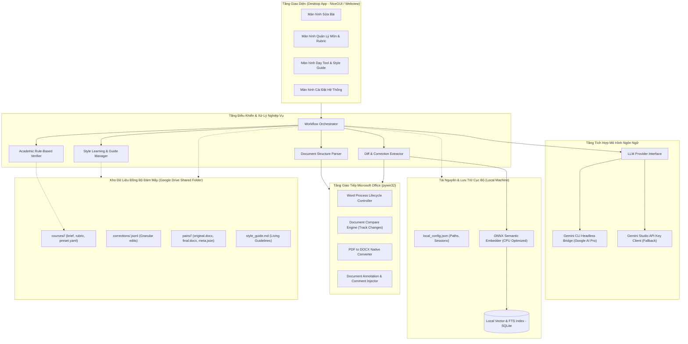
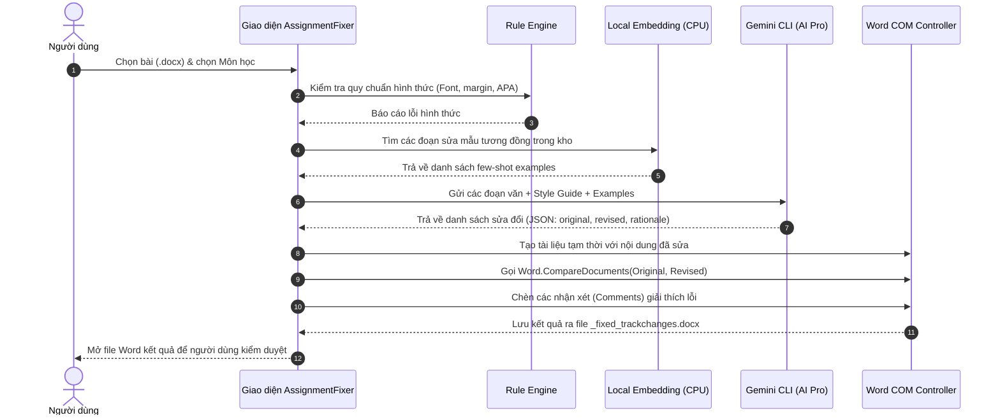
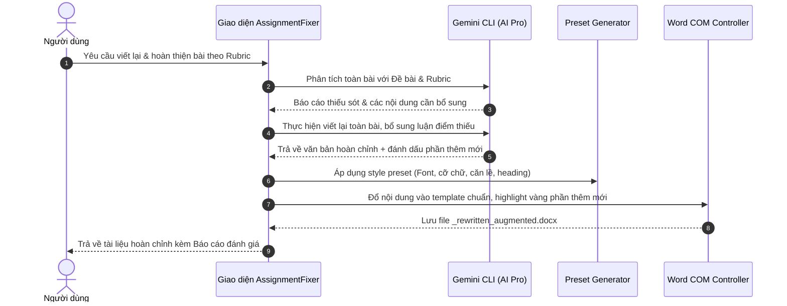
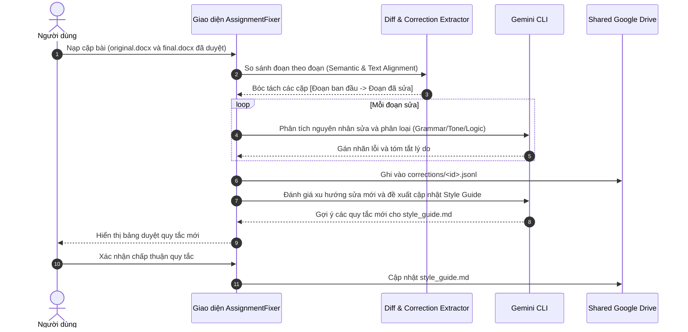

# Kiến trúc hệ thống — AssignmentFixer

Tài liệu này mô tả chi tiết thiết kế kiến trúc kỹ thuật của hệ thống **AssignmentFixer**, bao gồm các tầng xử lý, tương tác giữa các module, cơ chế kết nối Microsoft Word COM, cơ chế gọi mô hình ngôn ngữ lớn (Gemini CLI / API), bộ nhớ ngữ nghĩa cục bộ và chiến lược đồng bộ dữ liệu qua đám mây.

---

## 1. Sơ đồ khối tổng thể (System Component Diagram)



---

## 2. Thiết kế chi tiết các phân hệ (Subsystems)

### 2.1. Phân hệ Giao tiếp Microsoft Word COM (`word_com.py`)

Microsoft Word cung cấp bộ công cụ mạnh mẽ nhất về xử lý định dạng chuẩn `.docx`, khả năng so sánh văn bản (Document Compare) và chuyển đổi tài liệu. Hệ thống sử dụng thư viện `pywin32` tương tác trực tiếp với tiến trình `WINWORD.EXE`.

#### Nguyên lý vận hành:
1. **Quản lý vòng đời tiến trình (Process Lifecycle):**
   - Khởi tạo tiến trình Word ẩn (`Visible = False`, `DisplayAlerts = False`).
   - Đảm bảo cơ chế đóng file và giải phóng COM Object qua khối `try ... finally` để tránh rò rỉ tiến trình chạy ngầm làm khóa file trong bộ nhớ.
   - Thiết lập Timeout (30–60 giây) cho mọi tác vụ COM để ngăn hiện tượng treo app khi Word hiển thị popup bảo mật hoặc hộp thoại modal.
2. **Cơ chế so sánh tạo Track Changes (`WordCompare`):**
   - Thay vì dùng thư viện tự tạo thẻ XML `<w:ins>` và `<w:del>` (dễ gây lỗi cấu trúc file Word phức tạp), hệ thống dùng trực tiếp hàm API của Word:
     ```python
     # word.CompareDocuments(OriginalDoc, RevisedDoc, Destination, ...)
     ```
   - Kết quả xuất ra là một file `.docx` có Track Changes nguyên bản và hoàn toàn tương thích với tất cả các phiên bản Office.
3. **Chuyển đổi PDF sang DOCX (`WordConverter`):**
   - Tận dụng tính năng PDF Reflow tích hợp sẵn của Word 2016/2019/2021/365 để mở file `.pdf` và lưu thành file `.docx` có thể chỉnh sửa cấu trúc mà không cần phụ thuộc vào thư viện OCR ngoài.
4. **Chèn Comments tự động (`WordCommenter`):**
   - Chèn các nhận xét giải thích lỗi trực tiếp vào các đoạn văn tương ứng trong file Word bằng API `Document.Comments.Add(Range, Text)`.

---

### 2.2. Phân hệ Kiểm tra Quy chuẩn Hình thức bằng Luật Cứng (`rule_checker.py`)

Các lỗi hình thức bài thi học thuật không được giao cho LLM xử lý vì LLM thường hallucinate kích thước lề hoặc font chữ. Module này kiểm tra cấu trúc tài liệu bằng `python-docx` và so khớp với `preset.yaml` của môn học:

- **Quy tắc Font chữ & Kích thước:** Quét tất cả `runs` trong các `paragraphs` và `tables`, phát hiện font không đồng nhất (ví dụ: lẫn lộn Arial và Times New Roman, cỡ chữ không phải 12 hoặc 13 pt).
- **Quy chuẩn dãn dòng & lề:** Kiểm tra `paragraph_format.line_spacing` (thường là 1.15, 1.3 hoặc 1.5 line) và `space_after` / `space_before`, `sections[].left_margin`, `right_margin`, `top_margin`, `bottom_margin` (chuẩn 1 inch / 2.54 cm).
- **Phân cấp Tiêu đề (Heading Hierarchy):** Kiểm tra thứ tự logic của Heading 1 -> Heading 2 -> Heading 3, phát hiện hiện tượng nhảy cấp hoặc thiếu style heading chuẩn.
- **Tiêu đề Bảng & Hình ảnh:** Kiểm tra xem mỗi hình ảnh và bảng biểu có caption đánh số (Table 1, Figure 1) và nguồn trích dẫn (Source: ...) phía dưới hay không.
- **Quy cách Trích dẫn (APA 7 / Harvard):**
  - Dùng RegEx chuyên sâu để quét các trích dẫn in-text: `(Author, Year)`, `Author (Year)`, `(Author1 & Author2, Year)`, `(Author et al., Year)`.
  - Đối chiếu danh sách in-text citations với danh mục tài liệu tham khảo (References / Bibliography) ở cuối bài:
    - Báo lỗi nếu có nguồn trong bài nhưng thiếu trong References.
    - Báo lỗi nếu có nguồn trong References nhưng không được trích dẫn trong bài (phantom references).

---

### 2.3. Phân hệ Tích hợp Mô hình Ngôn ngữ (`llm/`)

Hệ thống thiết kế một lớp trừu tượng `LLMProviderInterface` giúp chuyển đổi linh hoạt giữa các backend AI:

```python
class LLMProviderInterface(ABC):
    @abstractmethod
    def evaluate_paper(self, paper_text: str, brief: str, rubric: str) -> EvaluationReport:
        pass

    @abstractmethod
    def fix_chunks(self, chunks: List[ChunkContext], style_guide: str, examples: List[CorrectionExample]) -> List[ChunkEdit]:
        pass

    @abstractmethod
    def rewrite_and_augment(self, paper_text: str, brief: str, rubric: str, missing_points: List[str]) -> str:
        pass
```

#### A. Backend Tùy chọn 1: Cổng API Chuẩn OpenAI — KiraAI (`openai_compatible.py`)
- **Ưu điểm vượt trội:**
  - Kết nối trực tiếp qua giao thức HTTP chuẩn (`https://kiraai.vn/api/v1/chat/completions`).
  - **Không yêu cầu cài Node.js, không cần đăng nhập trình duyệt OAuth:** Cực kỳ thuận lợi khi chuyển app sang máy laptop của partner (chỉ cần dán API Key vào app là chạy ngay).
  - Thanh toán linh hoạt bằng VNĐ (VietQR/MoMo), gói tokens rẻ và hỗ trợ các model Gemini 3.5 Flash & 2.5 Pro với context 1.0M tokens.
- **Cơ chế gọi:** Sử dụng thư viện `requests`/`httpx` chuẩn, hỗ trợ truyền `system` và `user` prompts, trả về phản hồi JSON có kiểm soát schema.

#### B. Backend Tùy chọn 2: Gemini CLI Headless Bridge (`gemini_cli.py`)
- **Động lực:** Tận dụng 1.500 requests/ngày từ tài khoản **Google AI Pro** thông qua Gemini CLI mà không tốn chi phí token trả theo dung lượng của API key.
- **Cơ chế gọi:**
  ```powershell
  gemini --prompt "<prompt_content>" --output-format json
  ```
- **Xử lý cách ly môi trường (Sandboxing & Safety Controls):**
  - Vì Gemini CLI mặc định là một coding agent có quyền gọi tool (đọc/ghi file hệ thống), phân hệ này thực hiện:
    1. Thiết lập thư mục làm việc tạm (`cwd`) độc lập, không chứa mã nguồn dự án.
    2. Cấu hình cấm sử dụng các công cụ thao tác tệp tin hoặc bash qua tham số hoặc file cấu hình settings của CLI.
    3. Đè cấu hình System Prompt qua biến môi trường hoặc tham số stdin để ép mô hình đóng vai một chuyên gia hiệu đính học thuật NEU (Academic Proofreader & Reviewer).
    4. Phân tích cú pháp chuỗi JSON trả về (`response` field), lọc bỏ các thông tin thống kê token và nhật ký session.

#### B. Backend Dự phòng: Gemini API Client (`gemini_api.py`)
- Tích hợp trực tiếp qua SDK Google GenAI / REST API.
- Dùng khóa API tạo từ AI Studio (gói miễn phí hoặc trả phí).
- Tự động kích hoạt khi Gemini CLI gặp sự cố quá hạn ngạch (rate limit), lỗi mạng hoặc phiên đăng nhập hết hạn.

---

### 2.4. Phân hệ Bộ nhớ Ngữ nghĩa & Tìm kiếm Ví dụ (`embedding_search.py`)

Để hệ thống sửa bài ngày càng giống với phong cách của người dùng mà không cần fine-tune model tốn kém:

1. **Model nhúng cục bộ (Local Embedder):**
   - Sử dụng model nhúng câu nhỏ gọn chạy hoàn toàn trên CPU thông qua **ONNX Runtime** (ví dụ: `all-MiniLM-L6-v2` hoặc tương đương, dung lượng chỉ khoảng 80–90MB).
   - Tốc độ nhúng văn bản: dưới 20ms cho mỗi đoạn văn, không cần card đồ họa rời, chạy mượt trên cả chip AMD văn phòng.
2. **Cơ chế lưu trữ và lập chỉ mục:**
   - Mỗi máy tự duy trì một file SQLite cục bộ (`local_index.db`) chứa vector nhúng của toàn bộ các đoạn sửa trong thư mục `corrections/` trên Google Drive.
   - Khi có tệp `.jsonl` mới được thêm vào từ máy bất kỳ trên Google Drive, trình quét nền sẽ tự động phát hiện và cập nhật vector vào SQLite cục bộ.
3. **Cơ chế truy vấn Few-Shot Dynamic Context:**
   - Khi chuẩn bị gửi một đoạn văn cho LLM sửa, hệ thống nhúng đoạn văn đó và tìm 3–5 đoạn có lỗi ngữ nghĩa tương tự trong quá khứ kèm theo cách bạn đã sửa.
   - Các mẫu này được đưa trực tiếp vào prompt dưới dạng các cặp `Input -> Output + Rationale`, giúp LLM bắt chước chính xác phong cách học thuật của bạn.

---

### 2.5. Chiến lược Đồng bộ Hóa Google Drive (Multi-Device Sync Architecture)

Để đảm bảo hai máy tính (máy chính và máy partner) làm việc chung mượt mà mà không gặp lỗi xung đột tập tin (File Lock Conflict) do các tiện ích đồng bộ đám mây (Google Drive / OneDrive / Dropbox):

1. **Nguyên tắc "File-per-Entity" (Tập tin độc lập):**
   - Tuyệt đối **không** chia sẻ một file SQLite database duy nhất trên Google Drive.
   - Dữ liệu được băm nhỏ thành các tập tin phi trạng thái:
     - Môn học: `courses/<course_code>/preset.yaml`
     - Cặp bài sửa: `pairs/<pair_uuid>/` (chứa `original.docx`, `final.docx`, `meta.json`)
     - Kho đoạn sửa: `corrections/<pair_uuid>.jsonl`
     - Bộ quy tắc phong cách: `style_guide.md`
2. **Quy tắc phân định quyền ghi (Atomic Append & Write):**
   - Mỗi file dữ liệu sinh ra được gắn UUID và định danh máy tạo (`machine_id`).
   - `style_guide.md` có cơ chế kiểm tra phiên bản (version timestamp); nếu phát hiện xung đột, app sẽ hiển thị giao diện đối chiếu để người dùng chấp nhận phiên bản mới nhất.
3. **Chỉ mục cục bộ riêng biệt:**
   - Mỗi máy tính tự đọc các file `.jsonl` từ Google Drive về để tự xây chỉ mục tìm kiếm và vector embedding riêng trên ổ cứng máy mình.

---

## 3. Các Luồng Nghiệp Vụ Chính (Sequence Workflows)

### 3.1. Luồng Sửa bài Chế độ Nhẹ (Light Fix Workflow)



---

### 3.2. Luồng Sửa bài Chế độ Nặng (Heavy Rewrite & Augmentation)



---

### 3.3. Luồng Tự Học Phong Cách (Style Learning Loop)


